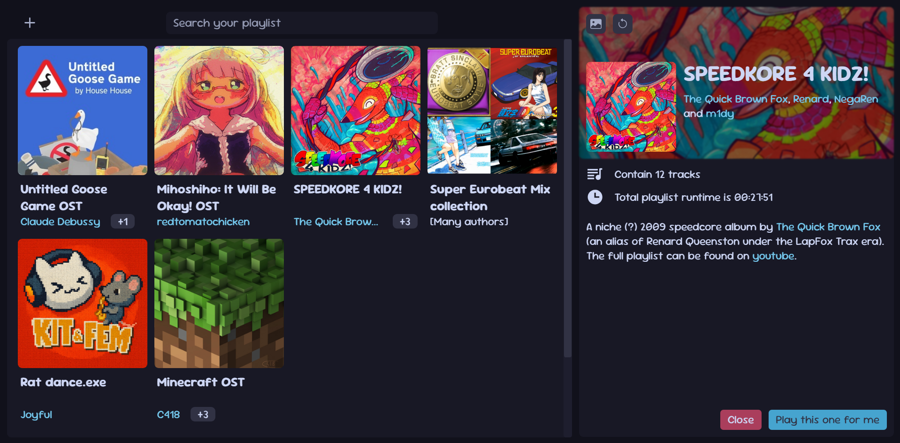

# Why?
Youtube and Spotify are simply eating too much RAM for my average vibing/listening to music activity, so I quickly wrote a quick playlist app that run directly in my browser.

Yes, everything is running locally, the app does not try to host anything publicly, it's directly in your computer.

